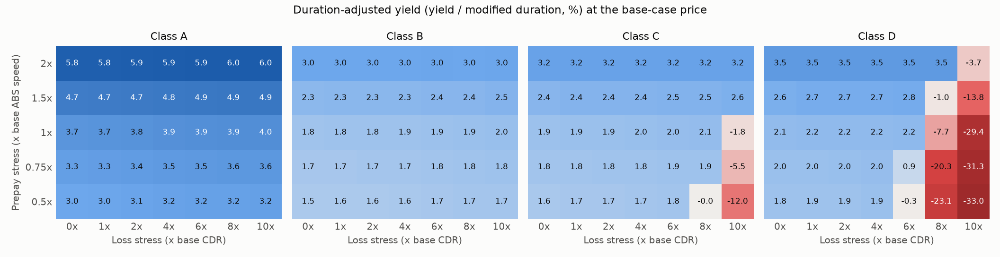
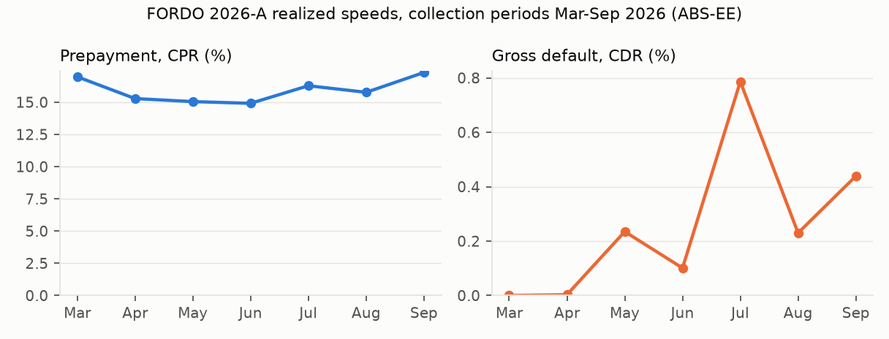

# ABS Waterfall and Tranche Risk

A Python engine for securitized-products risk. It projects an auto-loan pool's cash flows,
runs them through a sequential-pay waterfall, and measures each tranche's yield, duration,
spread, stress behaviour and market risk. It is calibrated to a public deal, Ford Credit
Auto Owner Trust 2026-A (FORDO 2026-A), from the SEC's loan-level filings.

## What it does

| Step | Module | Output |
|---|---|---|
| Collateral | `collateral.py` | Rep-line (or loan-level) amortization of fixed- and floating-rate pools; CPR/SMM and auto-ABS prepayment speeds, CDR/MDR defaults, severity, recovery lag, ramp-and-plateau vectors, prepay and loss stress multipliers, 10% clean-up call |
| Waterfall | `waterfall.py` | Fees, then interest top-down, principal top-down and losses bottom-up across Class A/B/C/D plus equity; OC target with turbo, reserve account, pro-rata pay switching to sequential on a cumulative-loss trigger |
| Tranche analytics | `analytics.py` | Price/yield, WAL, principal window, Macaulay and modified duration, convexity, duration-adjusted yield, I-spread to the Treasury curve; YT-style scenario tables, prepay x loss stress grid, break-even loss multiples |
| Market risk | `risk.py`, `curve.py` | PV01 and CS01 by bump-and-reprice off a bootstrapped Treasury zero curve; historical and hypothetical stress scenarios; historical-simulation VaR and ES |
| Real data | `edgar.py`, `deals.py` | Downloads and parses Reg AB II ABS-EE loan tapes and 10-D investor reports, reconciles the two, estimates realized ABS speed, CPR, CDR and severity, and builds rep lines |
| Reporting | `report.py`, `run_all.py` | `reports/report.md`, the CSV tables and every figure, from one command |

## The two deals

**SYNTH 2026-1** is a synthetic prime-auto deal, not modeled on any issuer. It has a $1.0bn
pool in three rep lines (WAC 8.21%, 48 to 72 months remaining) and 1.00% servicing.
The classes are A/B/C/D at 86.0/4.5/3.5/2.5% of the pool. Initial OC is 3.5%,
growing to a target of 5% of the current pool (floor 1% of the original). There is a 0.5%
non-declining reserve and a 10% clean-up call. The base case assumes 1.40% ABS
prepayment, a CDR ramping from 0.4% to 1.6% over 12 months, 50% severity and a
4-month recovery lag. That gives a 1.14% cumulative net loss (CNL). Coupons, and the
spreads used to set prices (+55/85/115/175bp to the Treasury at WAL), are assumptions.

**FORDO 2026-A** is built from public SEC filings:

- **Loan tapes.** Seven monthly ABS-EE tapes (Exhibit 102) for the March to September 2026
  collection periods, about 900 MB in total. The pool had 39,024 receivables and
  $1,488.96mm at cutoff.
- **Investor reports.** The matching 10-D monthly investor reports.
- **Collateral.** The September tape is stratified into 35 rep lines by APR and remaining term.
- **Note balances and coupons.** From the latest 10-D: A-2a 4.02%, A-2b SOFR + 0.43%,
  A-3 4.05%, A-4 4.16%, B 4.34% and C 0.00%.
- **Target OC.** In the 10-Ds, target OC is always the yield-supplement OC plus a constant
  $28.42mm. The model keeps that constant and holds the yield-supplement OC at its current
  4.39% of the pool.

## Sample output (`python run_all.py`, Treasury curve of 2026-10-21)

The full report is in [reports/report.md](reports/report.md).

**SYNTH 2026-1 base case**

| class | size ($mm) | coupon (%) | sub + OC (%) | price | yield (%) | WAL (yr) | mod dur | dur-adj yield (%) | I-spread (bp) |
|---|---:|---:|---:|---:|---:|---:|---:|---:|---:|
| A | 860.0 | 5.30 | 14.0 | 100.20 | 5.22 | 1.51 | 1.40 | 3.73 | 55 |
| B | 45.0 | 5.75 | 9.5 | 100.20 | 5.76 | 3.57 | 3.15 | 1.83 | 85 |
| C | 35.0 | 6.05 | 6.0 | 100.22 | 6.06 | 3.58 | 3.14 | 1.93 | 115 |
| D | 25.0 | 6.70 | 3.5 | 100.42 | 6.66 | 3.58 | 3.09 | 2.15 | 175 |

**YT-style table, Class A at a fixed price, across prepay scenarios**

| Class A | 1.40 ABS (base) | 0 CPR | 10 CPR | 15 CPR | 20 CPR | 25 CPR | 30 CPR |
|---|---:|---:|---:|---:|---:|---:|---:|
| Price | 100.197 | 100.197 | 100.197 | 100.197 | 100.197 | 100.197 | 100.197 |
| Yield (%) | 5.218 | 5.264 | 5.244 | 5.232 | 5.219 | 5.205 | 5.190 |
| Avg Life (yr) | 1.51 | 2.30 | 1.87 | 1.69 | 1.53 | 1.38 | 1.25 |
| Mod Dur | 1.40 | 2.08 | 1.71 | 1.55 | 1.41 | 1.28 | 1.16 |
| Principal Window | 11/26-04/30 | 11/26-05/31 | 11/26-12/30 | 11/26-09/30 | 11/26-07/30 | 11/26-04/30 | 11/26-01/30 |
| I-Spread (bp) | 55 | 43 | 47 | 51 | 55 | 58 | 60 |

**Nominal vs default-adjusted yield** (base-case price and prepay, loss stress as a
multiple of base CDR). The 0x column is the nominal yield. Pool CNL is 1.14% at 1x,
4.39% at 4x and 10.10% at 10x.

| class | 0x | 1x | 4x | 6x | 8x | 10x | break-even loss mult | break-even CNL (%) |
|---|---:|---:|---:|---:|---:|---:|---:|---:|
| A | 5.22 | 5.22 | 5.21 | 5.21 | 5.21 | 5.21 | 17.7 | 16.2 |
| B | 5.76 | 5.76 | 5.76 | 5.75 | 5.75 | 5.75 | 12.4 | 12.2 |
| C | 6.06 | 6.06 | 6.06 | 6.05 | 6.05 | -5.53 | 8.8 | 9.0 |
| D | 6.66 | 6.66 | 6.65 | 6.65 | -24.98 | -97.49 | 6.0 | 6.4 |

Up to 6x base losses, every note's yield stays within 1bp of nominal. Excess spread and OC
absorb the losses, and the equity IRR falls from 27.0% at 1x to -15.5% at 4x (equity
assumed to fund the initial OC and reserve at par). Beyond that, the subordinate classes'
default-adjusted yields diverge sharply from their nominal yields. D first loses principal
at 6.0x base losses (CNL 6.4%), C at 8.8x, B at 12.4x and A at 17.7x.

**Duration-adjusted yield (yield / modified duration) over a prepay x loss stress grid**



Class A's duration-adjusted yield *rises* with loss stress. Defaults accelerate A's
principal through the OC turbo, which shortens its duration. In 27 of the 35 cells, B, C
and D are repaid within the last two payment dates before the clean-up call, so their
duration follows the call date.

**PV01 and CS01** (bump-and-reprice, per 100 face). For fixed-rate classes, PV01, CS01 and
modified duration x price agree within 0.25%, because auto prepayments are modelled as
rate-insensitive. FORDO's floating A-2b has almost no rate risk but the same spread risk as
the fixed A-2a.

| class | PV01 | CS01 | mod dur x price x 1bp |
|---|---:|---:|---:|
| SYNTH A | 0.0140 | 0.0140 | 0.0140 |
| SYNTH D | 0.0311 | 0.0311 | 0.0311 |
| FORDO A-2a (fixed) | 0.0054 | 0.0054 | 0.0054 |
| FORDO A-2b (SOFR floater) | -0.0001 | 0.0054 | n/a |

**Stress and VaR** (positions: A $50mm, B $10mm, C $10mm and D $5mm face). Under full
revaluation, a parallel +100bp move costs $1.46mm. Widening spreads by
+50/100/150/250bp (A/B/C/D) costs $1.49mm, and the 2022 hiking-cycle curve move
costs $4.95mm. The 1-day 99% historical-simulation VaR is $175,971 (ES $219,574) over 500
days. That figure is **rates only**: FRED, the source of the credit-spread history, was down
for maintenance when this report was built. `make data` adds the spread leg once FRED can be
reached.

### FORDO 2026-A: data checks and calibration

| check: loan tape vs 10-D report (7 months) | max abs diff |
|---|---:|
| Pool balance, beginning and ending | < $0.01 |
| Charge-offs, recoveries | < $0.01 |
| Receivables outstanding | 2 loans |
| Principal collected, ex-defaults | 0.13% |



- **Calibrated speeds.** Trailing four-month, balance-weighted: 1.17% ABS (about 16% CPR)
  and 0.39% CDR.
- **Severity.** 46.5%, from cumulative net losses over cumulative gross defaults.
- **In-sample check.** Projecting the cutoff pool forward with the average realized speeds
  stays within 0.36% of the actual 10-D pool balance in every month. The speeds were fitted
  on these same months, so this checks the amortization engine; it is not a forecast test.

**Class A-3 YT-style table** (price from an assumed +45bp spread)

| Class A-3 | 0.50 ABS | 1.00 ABS | 1.17 ABS (calibrated) | 1.50 ABS | 1.80 ABS | 2.00 ABS |
|---|---:|---:|---:|---:|---:|---:|
| Price | 97.957 | 97.957 | 97.957 | 97.957 | 97.957 | 97.957 |
| Yield (%) | 5.024 | 5.168 | 5.234 | 5.388 | 5.570 | 5.718 |
| Avg Life (yr) | 2.36 | 2.03 | 1.91 | 1.68 | 1.47 | 1.33 |
| Mod Dur | 2.19 | 1.90 | 1.79 | 1.58 | 1.38 | 1.26 |
| Principal Window | 03/28-03/30 | 01/28-11/29 | 12/27-09/29 | 10/27-05/29 | 08/27-01/29 | 07/27-10/28 |
| I-Spread (bp) | 19 | 36 | 45 | 67 | 91 | 110 |

## Run it

```bash
make setup          # python3 -m venv .venv && pip install -r requirements.txt
make all            # reproduce reports/ from the cached data in data/ (a few seconds)
make test           # 23 tests
export EDGAR_USER_AGENT="Your Name you@example.com"
make data           # re-download filings and market data (about 1 GB), then rebuild
```

EDGAR fair access is respected: every request sends a User-Agent with a contact email,
and requests are spaced 0.25 seconds apart.

## Tests

- **Cash conservation, every period.** Collections plus reserve draws equal fees, tranche
  interest and principal, reserve deposits and the equity residual. This is checked for
  base, stressed, pro-rata/trigger and floating-rate structures.
- **Par conservation, every tranche.** Principal paid plus write-downs equals original face.
- **Closed form.** With no defaults or prepayments, the pool reproduces the level-pay
  annuity payment and balance schedule exactly.
- **Loss allocation.** Losses are allocated bottom-up. Higher CDR never increases B, C, D
  or equity cash flow, and the senior WAL shortens as CPR rises.
- **PV01.** Bump-and-reprice PV01 matches modified duration x price: within 0.3% on a flat
  curve and 2% on a sloped curve.
- **Other checks.** The trigger switches pro-rata to sequential, the bootstrapped curve
  reprices par bonds, a floater's PV01 is near zero, and VaR scenario P&L matches PV01 for a
  parallel move. The ABS-EE parser and speed estimators are tested on a hand-built tape.

## Assumptions and limitations

- **Collateral.** Rep-line, level-pay amortization. Defaults hit the beginning balance
  before scheduled principal. Defaulted loans pay nothing until liquidation `lag` months
  later. There is no delinquency or servicer advancing.
- **Waterfall.** All note interest is paid before any principal. Real auto deals
  interleave "first/second priority principal" with junior interest, which matters only
  in deep stress. Notes are written down when the pool no longer covers them; in a real
  auto deal the shortfall instead remains unpaid at legal final maturity, which is the
  same economic loss. Interest shortfalls carry forward without interest. There are no
  trustee fees.
- **FORDO structure.** Yield-supplement OC is held at a constant share of the pool. The
  10% clean-up call is assumed to be measured against the cutoff pool. The SOFR index
  is held flat at the level implied by the A-2b coupon.
- **Prices are not market quotes.** They come from assumed spreads to the interpolated
  Treasury at WAL. No Bloomberg, Intex or other vendor data is used.
- **Rate-insensitive prepayments.** Prepayments do not depend on rates, so effective
  duration equals modified duration, and a fixed-rate class has the same rate and spread
  risk.
- **Calibration.** It uses only seven early-life months. Auto-loan losses usually rise as
  a pool seasons, so the calibrated CDR (0.39%) is not a lifetime loss forecast. The
  severity rests on about $1.9mm of gross defaults. The recovery lag (3 months) is assumed.
- **Stress scenarios.** Historical scenarios use actual Treasury curve moves over each
  window. They include spread moves only if spread history covers the window, which it does
  not in this build. That is why "2008 Lehman" shows a gain: without the spread leg it
  captures only the rally in Treasuries. Collateral overlays (CDR, severity, prepay) on
  those windows are assumptions.
- **VaR.** 1-day horizon, full revaluation on base-case cash flows. The spread leg uses
  ICE BofA corporate OAS by rating (AAA/AA/A/BBB for A/B/C/D) as a proxy. ABS spreads do
  not move one-for-one with corporate spreads.

## Data

| Source | Use | In repo |
|---|---|---|
| SEC EDGAR, Form ABS-EE (Ex-102) and Form 10-D (Ex-99), CIK 2113024 | Loan tapes and investor reports for FORDO 2026-A | Derived CSVs in `data/fordo2026a/`; raw filings are git-ignored |
| Treasury.gov daily par yield curve | Pricing curve, rate history | `data/treasury_par_curve.csv` |
| FRED, ICE BofA US corporate OAS | Spread history for VaR | `data/credit_spreads.csv` when available |
