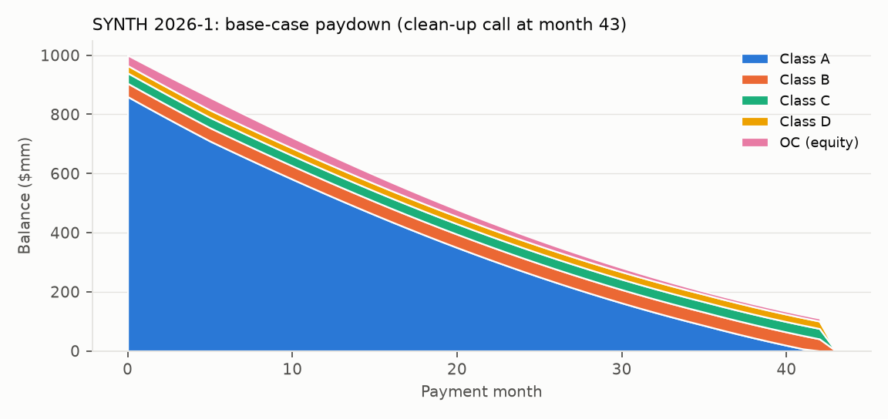

# ABS waterfall and tranche risk report

Generated by `python run_all.py`. Treasury par curve as of 2026-10-21 (Treasury.gov).

## 1. SYNTH 2026-1 (synthetic prime auto)

Pool $1,000mm, WAC 8.21%, servicing 1.00%. Base case: 1.40% ABS prepayment, CDR ramping 0.4% to 1.6% over 12 months, severity 50%, 4-month recovery lag, 10% clean-up call. Base-case cumulative net loss 1.14% of the original pool.

### Base-case tranche analytics

Prices are set at assumed spreads to the interpolated Treasury at WAL (A/B/C/D +55, +85, +115, +175bp); Treasury curve as of 2026-10-21.

| class | size ($mm) | coupon (%) | subordination+OC (%) | price | yield (%) | WAL (yr) | mod dur | convexity | dur-adj yield (%) | I-spread (bp) |
|---|---:|---:|---:|---:|---:|---:|---:|---:|---:|---:|
| A | 860.00 | 5.30 | 14.00 | 100.20 | 5.22 | 1.51 | 1.40 | 3.50 | 3.73 | 55.00 |
| B | 45.00 | 5.75 | 9.50 | 100.20 | 5.76 | 3.57 | 3.15 | 12.10 | 1.83 | 85.00 |
| C | 35.00 | 6.05 | 6.00 | 100.22 | 6.06 | 3.58 | 3.14 | 12.04 | 1.93 | 115.00 |
| D | 25.00 | 6.70 | 3.50 | 100.42 | 6.66 | 3.58 | 3.09 | 11.80 | 2.15 | 175.00 |

### YT-style tables (fixed price, prepay scenarios, base defaults)

| Class A | 1.40 ABS (base) | 0 CPR | 10 CPR | 15 CPR | 20 CPR | 25 CPR | 30 CPR |
|---|---:|---:|---:|---:|---:|---:|---:|
| Price | 100.197 | 100.197 | 100.197 | 100.197 | 100.197 | 100.197 | 100.197 |
| Yield (%) | 5.218 | 5.264 | 5.244 | 5.232 | 5.219 | 5.205 | 5.190 |
| Avg Life (yr) | 1.51 | 2.30 | 1.87 | 1.69 | 1.53 | 1.38 | 1.25 |
| Mod Dur | 1.40 | 2.08 | 1.71 | 1.55 | 1.41 | 1.28 | 1.16 |
| Principal Window | 11/26-04/30 | 11/26-05/31 | 11/26-12/30 | 11/26-09/30 | 11/26-07/30 | 11/26-04/30 | 11/26-01/30 |
| I-Spread (bp) | 55 | 43 | 47 | 51 | 55 | 58 | 60 |

| Class B | 1.40 ABS (base) | 0 CPR | 10 CPR | 15 CPR | 20 CPR | 25 CPR | 30 CPR |
|---|---:|---:|---:|---:|---:|---:|---:|
| Price | 100.196 | 100.196 | 100.196 | 100.196 | 100.196 | 100.196 | 100.196 |
| Yield (%) | 5.757 | 5.770 | 5.767 | 5.764 | 5.761 | 5.758 | 5.754 |
| Avg Life (yr) | 3.57 | 4.66 | 4.30 | 4.05 | 3.82 | 3.64 | 3.39 |
| Mod Dur | 3.15 | 3.98 | 3.71 | 3.52 | 3.34 | 3.20 | 3.00 |
| Principal Window | 04/30-05/30 | 05/31-06/31 | 12/30-02/31 | 09/30-11/30 | 07/30-08/30 | 04/30-06/30 | 01/30-03/30 |
| I-Spread (bp) | 85 | 83 | 84 | 84 | 85 | 85 | 85 |

| Class C | 1.40 ABS (base) | 0 CPR | 10 CPR | 15 CPR | 20 CPR | 25 CPR | 30 CPR |
|---|---:|---:|---:|---:|---:|---:|---:|
| Price | 100.217 | 100.217 | 100.217 | 100.217 | 100.217 | 100.217 | 100.217 |
| Yield (%) | 6.058 | 6.072 | 6.068 | 6.065 | 6.062 | 6.059 | 6.054 |
| Avg Life (yr) | 3.58 | 4.67 | 4.33 | 4.08 | 3.83 | 3.67 | 3.42 |
| Mod Dur | 3.14 | 3.96 | 3.71 | 3.52 | 3.33 | 3.20 | 3.00 |
| Principal Window | 05/30-05/30 | 06/31-06/31 | 02/31-02/31 | 11/30-11/30 | 08/30-08/30 | 06/30-06/30 | 03/30-03/30 |
| I-Spread (bp) | 115 | 113 | 114 | 114 | 115 | 115 | 115 |

| Class D | 1.40 ABS (base) | 0 CPR | 10 CPR | 15 CPR | 20 CPR | 25 CPR | 30 CPR |
|---|---:|---:|---:|---:|---:|---:|---:|
| Price | 100.424 | 100.424 | 100.424 | 100.424 | 100.424 | 100.424 | 100.424 |
| Yield (%) | 6.657 | 6.686 | 6.678 | 6.672 | 6.665 | 6.660 | 6.652 |
| Avg Life (yr) | 3.58 | 4.67 | 4.33 | 4.08 | 3.83 | 3.67 | 3.42 |
| Mod Dur | 3.09 | 3.89 | 3.65 | 3.47 | 3.28 | 3.16 | 2.97 |
| Principal Window | 05/30-05/30 | 06/31-06/31 | 02/31-02/31 | 11/30-11/30 | 08/30-08/30 | 06/30-06/30 | 03/30-03/30 |
| I-Spread (bp) | 175 | 175 | 175 | 175 | 175 | 175 | 175 |

### Nominal vs default-adjusted yields

Yield at the base-case price as the loss stress rises (base prepay). The 0x column is the nominal (no-default) yield. Pool cumulative net loss by column: 0x = 0.00%, 1x = 1.14%, 2x = 2.25%, 4x = 4.39%, 6x = 6.40%, 8x = 8.31%, 10x = 10.10%. Equity IRR (funding the initial OC and reserve at par): 0x = 39.7%, 1x = 27.0%, 2x = 13.6%, 4x = -15.5%, 6x = -96.8%, 8x = -100.0%, 10x = -100.0%.

| class | yield @ 0x loss (%) | yield @ 1x loss (%) | yield @ 2x loss (%) | yield @ 4x loss (%) | yield @ 6x loss (%) | yield @ 8x loss (%) | yield @ 10x loss (%) | principal loss @ 10x (%) | break-even loss mult | break-even CNL (%) |
|---|---:|---:|---:|---:|---:|---:|---:|---:|---:|---:|
| A | 5.22 | 5.22 | 5.22 | 5.21 | 5.21 | 5.21 | 5.21 | 0.00 | 17.70 | 16.25 |
| B | 5.76 | 5.76 | 5.76 | 5.76 | 5.75 | 5.75 | 5.75 | 0.00 | 12.44 | 12.18 |
| C | 6.06 | 6.06 | 6.06 | 6.06 | 6.05 | 6.05 | -5.53 | 34.10 | 8.76 | 9.03 |
| D | 6.66 | 6.66 | 6.66 | 6.65 | 6.65 | -24.98 | -97.49 | 100.00 | 6.04 | 6.44 |

### Duration-adjusted yield, prepay x loss stress

### PV01 and CS01 (bump-and-reprice, per 100 face)

| class | price | mod_dur | pv01 | cs01 | dur_x_price | PV01 / (D x P) | PV01 per $1mm | CS01 per $1mm |
|---|---:|---:|---:|---:|---:|---:|---:|---:|
| A | 100.1965 | 1.3975 | 0.0140 | 0.0140 | 0.0140 | 1.0000 | 140.0310 | 139.8298 |
| B | 100.1957 | 3.1496 | 0.0316 | 0.0315 | 0.0316 | 1.0018 | 316.1465 | 315.4992 |
| C | 100.2174 | 3.1360 | 0.0315 | 0.0314 | 0.0314 | 1.0018 | 314.8409 | 314.1969 |
| D | 100.4236 | 3.0936 | 0.0311 | 0.0311 | 0.0311 | 1.0018 | 311.2142 | 310.5793 |

### Stress scenarios (full revaluation; position: A $50mm, B $10mm, C $10mm, D $5mm face)

| scenario | A price chg | B price chg | C price chg | D price chg | P&L |
|---|---:|---:|---:|---:|---:|
| 2008 Lehman (2008-09-12 to 2008-12-31), rates only | 2.26 | 4.96 | 4.94 | 4.90 | 2,367,384 |
| 2020 COVID (2020-02-21 to 2020-03-23), rates only | 1.66 | 3.33 | 3.33 | 3.31 | 1,662,082 |
| 2022 Fed hikes (2022-01-03 to 2022-10-21), rates only | -4.99 | -9.86 | -9.82 | -9.72 | -4,949,651 |
| Rates +100bp parallel | -1.38 | -3.10 | -3.09 | -3.05 | -1,463,187 |
| Rates -100bp parallel | 1.42 | 3.22 | 3.21 | 3.17 | 1,510,945 |
| Spreads A/B/C/D +50/100/150/250bp | -0.69 | -3.10 | -4.58 | -7.41 | -1,485,319 |
| Prepay x0.5 | -0.04 | -0.04 | -0.04 | -0.00 | -30,350 |
| Prepay x2.0 | 0.06 | 0.10 | 0.09 | 0.01 | 50,262 |
| CDR x4, severity 60% | 0.01 | 0.00 | 0.00 | -0.00 | 5,127 |
| Recession: rates -100, spreads widen x1.5, CDR x4, sev 60%, prepay x0.75 | 0.37 | -1.67 | -4.07 | -8.57 | -818,284 |

### Historical-simulation VaR (499 days, 2024-10-21 to 2026-10-20)

Daily changes in every Treasury par tenor, plus daily changes in ICE BofA corporate OAS by rating (AAA/AA/A/BBB as proxies for A/B/C/D), applied to today's curve with full revaluation.

|  | 1-day 99% VaR ($) | 1-day 99% ES ($) |
|---|---:|---:|
| Rates + spreads | 190,015 | 226,555 |
| Rates only | 176,179 | 219,574 |
| Spreads only | 39,112 | 71,633 |

## 2. FORDO 2026-A, calibrated to public SEC filings

Seven monthly ABS-EE loan tapes (Mar-Sep 2026 collection periods, 39,024 receivables at cutoff) and the matching 10-D investor reports.

### Data checks: loan tape vs. 10-D investor report

| check | max_abs_diff | max_rel_diff |
|---|---:|---:|
| Pool balance, beginning | 2.384e-07 | 1.9e-16 |
| Pool balance, ending | 2.384e-07 | 1.9e-16 |
| Receivables, beginning | 2 | 5.616e-05 |
| Charge-offs | 1.455e-11 | 1.648e-16 |
| Recoveries | 9.095e-13 | 2.164e-16 |
| Liquidation proceeds | 6.328e+04 | 0.4314 |
| Principal collected (ex-defaults) | 5.657e+04 | 0.001257 |

Liquidation proceeds differ by definition: the tape measure counts principal collected on receivables charged off that month, while the 10-D also counts repossession proceeds received before charge-off.

### Realized monthly performance (from the loan tapes)

| period | loans | begin pool ($mm) | ABS (%) | CPR (%) | CDR (%) | net loss ($k) | 60+ dq (%) |
|---|---:|---:|---:|---:|---:|---:|---:|
| 2026-03 | 39,024 | 1,488.96 | 1.29 | 16.97 | 0.00 | 0.34 | 0.01 |
| 2026-04 | 38,328 | 1,437.81 | 1.16 | 15.28 | 0.00 | 4.02 | 0.04 |
| 2026-05 | 37,439 | 1,390.72 | 1.14 | 15.05 | 0.23 | 66.59 | 0.04 |
| 2026-06 | 36,555 | 1,345.36 | 1.12 | 14.91 | 0.10 | 71.42 | 0.08 |
| 2026-07 | 35,608 | 1,300.79 | 1.20 | 16.28 | 0.79 | 469.75 | 0.10 |
| 2026-08 | 34,595 | 1,254.85 | 1.15 | 15.77 | 0.23 | 80.39 | 0.10 |
| 2026-09 | 33,706 | 1,211.81 | 1.24 | 17.31 | 0.44 | 204.47 | 0.09 |

Calibrated assumptions (trailing 4 months, balance-weighted): 1.17% ABS, 0.39% CDR; severity 46.5% (cumulative net loss / gross defaults since cutoff); recovery lag 3 months (assumed).

### In-sample check: cutoff pool projected with all-period average speeds

| period | model EOP pool ($mm) | 10-D EOP pool ($mm) | diff (%) |
|---|---:|---:|---:|
| 2026-03 | 1,440.32 | 1,437.81 | 0.17 |
| 2026-04 | 1,392.44 | 1,390.72 | 0.12 |
| 2026-05 | 1,345.35 | 1,345.36 | -0.00 |
| 2026-06 | 1,298.73 | 1,300.79 | -0.16 |
| 2026-07 | 1,252.91 | 1,254.85 | -0.15 |
| 2026-08 | 1,207.88 | 1,211.81 | -0.32 |
| 2026-09 | 1,163.66 | 1,167.82 | -0.36 |

### Class A-3 YT-style table

Settlement on the 10/15/2026 payment date; prices at assumed spreads (A-2a/A-3/A-4/B/C +35, +45, +55, +75, +100bp; A-2b at par); SOFR held at 3.649% (implied by the A-2b coupon).

| Class A-3 | 0.50 ABS | 1.00 ABS | 1.17 ABS (calibrated) | 1.50 ABS | 1.80 ABS | 2.00 ABS |
|---|---:|---:|---:|---:|---:|---:|
| Price | 97.957 | 97.957 | 97.957 | 97.957 | 97.957 | 97.957 |
| Yield (%) | 5.024 | 5.168 | 5.234 | 5.388 | 5.570 | 5.718 |
| Avg Life (yr) | 2.36 | 2.03 | 1.91 | 1.68 | 1.47 | 1.33 |
| Mod Dur | 2.19 | 1.90 | 1.79 | 1.58 | 1.38 | 1.26 |
| Principal Window | 03/28-03/30 | 01/28-11/29 | 12/27-09/29 | 10/27-05/29 | 08/27-01/29 | 07/27-10/28 |
| I-Spread (bp) | 19 | 36 | 45 | 67 | 91 | 110 |

### PV01 and CS01 (per 100 face); A-2b floats on SOFR

| class | price | mod_dur | pv01 | cs01 |
|---|---:|---:|---:|---:|
| A-2a | 99.6407 | 0.5390 | 0.0054 | 0.0054 |
| A-2b | 100.0000 | 0.5411 | -0.0001 | 0.0054 |
| A-3 | 97.9571 | 1.7879 | 0.0175 | 0.0175 |
| A-4 | 96.5199 | 2.8303 | 0.0274 | 0.0273 |
| B | 96.4091 | 2.8783 | 0.0278 | 0.0277 |
| C | 83.1955 | 3.0760 | 0.0256 | 0.0256 |

### Break-even loss multiples (calibrated base)

Net losses to date are 0.060% of the cutoff pool; the calibrated base case projects a further 0.22%. Break-even CNL counts future losses only, as a share of the cutoff pool. Early-life default rates understate lifetime losses for auto pools, so the base case is not a loss forecast.

|  | break-even loss mult | break-even CNL (%) |
|---|---:|---:|
| A-3 | 86.12 | 14.46 |
| A-4 | 51.09 | 9.47 |
| B | 35.05 | 6.82 |
| C | 25.48 | 5.10 |
